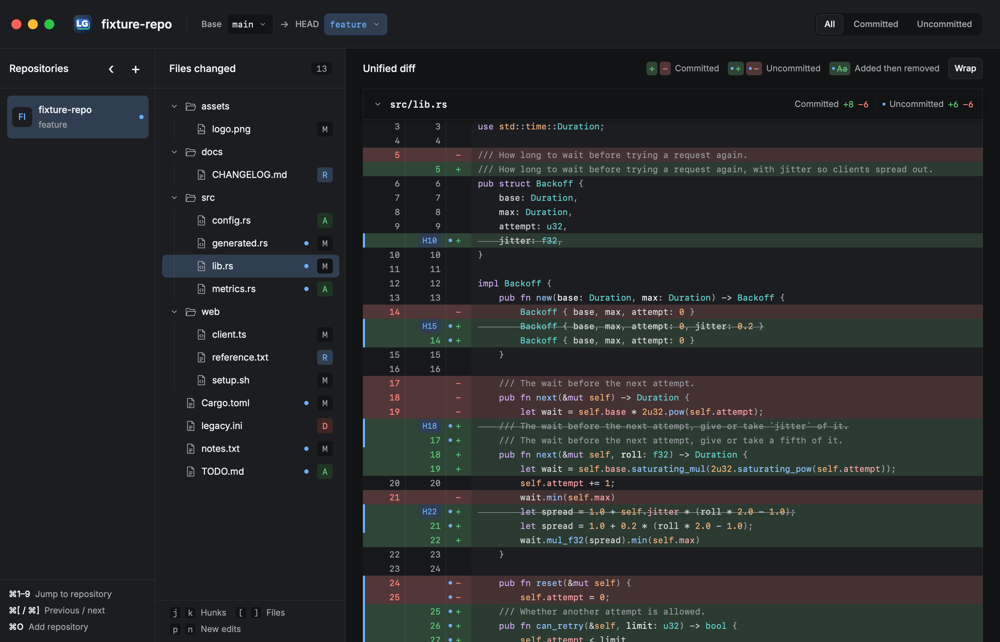

#  layeredgit

Run `layeredgit` in a Git repo to review your branch the way you would read a
GitHub pull request, without pushing. The name is a nod to
[lazygit](https://github.com/jesseduffield/lazygit).



### Review both layers

**All** interleaves committed and uncommitted edits in one unified diff. Green
and red tints mark additions and deletions. A blue edge and gutter dot flag
uncommitted edits, and strikethrough marks lines added in a commit and removed
in the worktree. **Committed** shows a two-way diff from merge base to HEAD.
**Uncommitted** shows a two-way diff from HEAD to worktree.

The app watches the filesystem and briefly pulses freshly changed lines. If
edits are off-screen, click the “N lines changed above/below” chip or press
`p` / `n` to jump to the nearest one above or below.

### Switch repositories and branches

Use the repositories sidebar, **⌘1–9**, or **⌘[** / **⌘]** to switch repos.
Search branches in the **Base** and **HEAD** pickers. If you select a head
checked out in another linked worktree, the diff includes that worktree’s
uncommitted changes. This is handy when reviewing an agent’s worktree.

- Syntax highlighting and sticky file headers help you scan the diff.
- Fold files or expand unchanged lines for context.
- Scroll long lines horizontally or turn on **Wrap**.
- Press `j` / `k` to move between hunks and `[` / `]` to move between files.
- Resize the side panels. Light and dark appearance follows macOS.

## Install on macOS

layeredgit runs on macOS and is built with [Rune](https://github.com/anomalyco/rune).
To build and install it, use Git 2.42 or newer, just, Python 3, and the Rust
toolchain pinned in [`rust-toolchain.toml`](rust-toolchain.toml) via rustup.
Run this from the checkout.

```sh
just install
```

This builds the release app, installs `~/Applications/layeredgit.app`, and puts
`layeredgit` in `~/.local/bin`. Add `~/.local/bin` to your shell's `PATH`, then run
`layeredgit` anywhere inside a working tree to add or select it in the app.
To override its base, run `layeredgit BASE`. The default tries `origin/HEAD`,
then `main`, then `master`.
Run `layeredgit --help` for usage or `man layeredgit` for the manual.

Open **layeredgit** from Finder, Spotlight, or the Dock to restore your
repositories in one window. Use **+** or **⌘O** to add a working tree.
Right-click a repository to remove it from the sidebar without changing
anything on disk, or collapse the sidebar to make more room for the diff.
Closing the window leaves the app in the Dock. Use **⌘Q** to quit.

The **Base** and **HEAD** pickers also accept a tag, commit ID, or revision
expression. The app remembers each repository’s base. HEAD defaults to the
checkout on launch. **Reset to current** restores it at any time. A branch
without a checkout, a remote-tracking ref, a tag, or a commit ID shows committed
changes only.

On first launch, a fresh installation imports saved repositories, comparison
bases, sidebar state, panel widths, and window frame from the previous app.

After pulling changes, run `just install` again. Rune's installer swaps the bundle
in place and relaunches a running app with its original arguments. Remove the
bundle, launcher, and manual with `just uninstall`. For another location,
set the same `APP_DIR` and `BIN_DIR` on both commands.

```sh
APP_DIR="$PWD/target/install-test/Applications" BIN_DIR="$PWD/target/install-test/bin" just install
APP_DIR="$PWD/target/install-test/Applications" BIN_DIR="$PWD/target/install-test/bin" just uninstall
```

## Development

Run `cargo run -- --repo .` to review the current working tree, `cargo run` for
the workspace, or `cargo run -- --demo` for the built-in example. Pass
`--base REF` to override the comparison base.

The review also checks Git status periodically. Press `r` to refresh immediately.

To render the fixture headlessly, run:

```sh
scripts/make-fixture-repo.sh target/fixture-repo
cargo run -- --repo target/fixture-repo --snap target/fixture.png --chrome --size 1400x900 --scale 2
cargo run -- --repo target/fixture-repo --script scripts/ui/large-file-fold.json --chrome --out target/fold-frames
```

Add `--scene reduced-motion` to any headless capture to exercise Reduce Motion.
Use `--demo-pulse` to simulate a reload at 0.5 seconds on the fixture.

To exercise the repository sidebar and revision pickers, generate disposable
fixtures and pass repeated `--repo` flags in a debug headless run. The last path
is selected, even if it appeared earlier in the list:

```sh
sh scripts/make-sidebar-fixtures.sh
F=target/round4-fixtures
cargo run -- --repo "$F/checkout/review-sample" --repo "$F/linked/review-sample" \
  --repo "$F/docs-lab" --repo "$F/checkout/review-sample" \
  --script scripts/ui/revision-pickers.json --chrome --size 1400x900 \
  --video target/revision-pickers.mp4 --keys --pointer
```

Use `scripts/ui/repository-workspace.json` with the same arguments to check
repository switching and collapse, or run `scripts/ui/repository-empty.json`
without any `--repo` flags to exercise first launch and the folder-dialog flow.

### Tune the diff colours

Run `cargo run --features dev -- --repo target/fixture-repo` and press **⌘⇧K**.
The panel opens the provenance controls for the current system appearance. To
preview the other palette, switch your system appearance or launch with
`--theme light` or `--theme dark`. The edge, gutter dot, and pulse colours use
OKLCH. Edit a working-tree line to see the pulse with the current settings.

Use **Copy** in the panel header to copy the selected group's values. In
[`src/palette.rs`](src/palette.rs), match each copied label to its row in
`palette! { … }`. Replace the penultimate number for Light or the final number
for Dark. Builds without `dev` use those defaults directly.

Rune is pinned to a Git revision in `Cargo.toml`. Update the dependency and its matching patches together when changing that pin.
